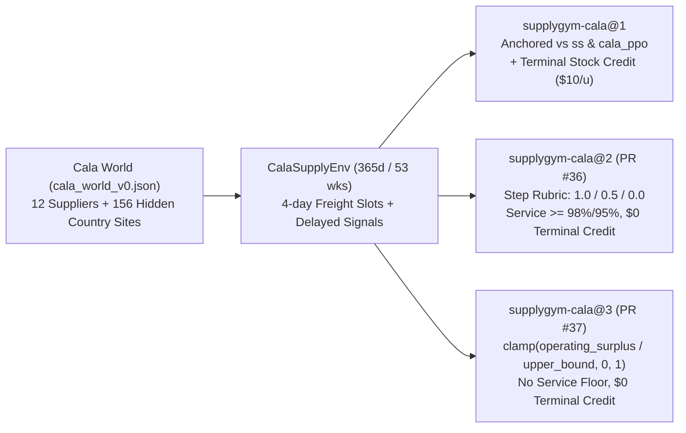

# Full Audit of PR #37: SupplyGym Cala (`supplygym-cala@3`), Harbor Compatibility & AfterQuery Hackathon Readiness

- **Audited PR:** [#37 — Add Cala upper-bound scoring and live spectator feeds](https://github.com/vaartnou/crucible/pull/37) (`SiimSaaresalu:codex/cala-live-upper-bound` → `codex/supplygym-cala-world`)
- **Audited Commit:** [`dba5c4907dc9d937a01f3fb292d7d800a99987af`](https://github.com/vaartnou/crucible/commit/dba5c4907dc9d937a01f3fb292d7d800a99987af) (includes stacked [#36](https://github.com/vaartnou/crucible/pull/36) and [#29](https://github.com/vaartnou/crucible/pull/29))
- **Audit Date:** 2026-11-15
- **Automated Verification Summary:** `pytest`: `748 passed, 1 Windows chmod platform failure, 24 skipped, 3 xfailed` | `ruff`: `0 errors` | `pyright`: `2 strict errors` in [`test_outcomes.py#L300-L301`](https://github.com/vaartnou/crucible/blob/dba5c4907dc9d937a01f3fb292d7d800a99987af/engine/src/crucible/envs/supplygym/tests/test_outcomes.py#L300-L301)

> [!CAUTION]
> **Executive Verdict — Not Ready to Merge or Submit As-Is (Estimated Rubric Risk: ~33–45 / 100 pts without fixes, vs. 85–95 / 100 pts with targeted fixes).**  
> The underlying **Cala multi-site supply-chain domain** and **Harbor sidecar security boundary** are genuinely strong, original, and cleanly isolated. However, PR #37 introduces severe regressions in **Reward Integrity**, **The Gap**, **Live Harbor OpenCode Execution**, and **README One-Command Reproducibility** that would cost major points during the judges' standard harness rerun and 15-minute exploit hunt.

---

## 1. AfterQuery Junction 2026 Rubric Scorecard (Current vs. Potential)

| Rubric Category | Max Pts | Current Est. | Root Cause of Risk in PR #37 | Fix Effort |
| :--- | :---: | :---: | :--- | :---: |
| **The Gap** | **30** | **0 – 10** | Zero real frontier LLM runs exist in the repo for any SupplyGym task; `reference` on `@3` was silently downgraded from `cala_ppo` to a 5-line `AvailabilityRule` that loses to `fill_adjusted_base_stock` (`30%` win rate on dev) and beats passive `ss` by only `+0.0022` on dev (`0.8030` vs `0.8008`). | Medium (`2–3 hrs` + 3 LLM runs) |
| **Meaningful Difficulty** | **30** | **16 – 20** | Authentic multi-site domain idea, **but**: (1) `120`-step budget across `53` weeks leaves only `13` spare calls if an LLM calls `get_status` + `set_controls` weekly, causing instant `0.0` wipeouts; (2) `3.2x` incumbent supplier overcapacity makes backup onboarding (`A01`/`A02`) and expediting strictly losing traps (`0/20` wins); (3) `finish` tool has zero valid uses in `@3` and acts purely as a `0.0`-score footgun; (4) runtime `profit_so_far` includes terminal stock credit while `@3` grading excludes it. | Low–Medium (`1–2 hrs`) |
| **Reward Integrity** | **25** | **5 – 10** | **Three confirmed exploits/flaws in `@3`**: (1) **End-of-year order starvation** (weeks `50–52`) beats `reference` on **`40/40` (`100%`)** of tested dev & held-out seeds (`+$617.61` to `+$675.69`/ep) because terminal stock/pipeline gets `$0` credit while orders take `18–21` days to arrive; (2) a **5-line blind open-loop script** (`0` observations read) beats `reference` on **`14/20` (`70%`)** dev and **`11/20` (`55%`)** held-out seeds; (3) empty `set_controls({})` × `53` earns **`~0.79–0.80`** (no baseline floor subtraction). | Low (`1 hr`) |
| **Craft** | **15** | **4 – 7** | Root [`README.md`](https://github.com/vaartnou/crucible/blob/dba5c4907dc9d937a01f3fb292d7d800a99987af/README.md#L6-L24) still presents `incident@1` as the AfterQuery submission with zero mention of `supplygym-cala@3`; [`run_cala_demo.py`](https://github.com/vaartnou/crucible/blob/dba5c4907dc9d937a01f3fb292d7d800a99987af/engine/scripts/run_cala_demo.py#L209-L232) omits `--ae` (causing `ProviderAuthError` in OpenCode), omits `reference`/`do_nothing`/`stop_early`, and [`CALA_LIVE_DEMO.md`](https://github.com/vaartnou/crucible/blob/dba5c4907dc9d937a01f3fb292d7d800a99987af/docs/supplygym/CALA_LIVE_DEMO.md#L33) uses non-existent model ID `google/gemini-4-hydrogen` (`404` error). | Low (`1 hr`) |

---

## 2. Audit of the Gym Solution, Domain Idea & Mechanics

### 2.1 Architecture & Registered Task Matrix (`@1`, `@2`, `@3`)



Importing [`crucible.envs.supplygym`](https://github.com/vaartnou/crucible/blob/dba5c4907dc9d937a01f3fb292d7d800a99987af/engine/src/crucible/envs/supplygym/__init__.py#L1-L23) registers **7 task variants** across [`task.py`](https://github.com/vaartnou/crucible/blob/dba5c4907dc9d937a01f3fb292d7d800a99987af/engine/src/crucible/envs/supplygym/task.py#L116-L285), [`cala_task.py`](https://github.com/vaartnou/crucible/blob/dba5c4907dc9d937a01f3fb292d7d800a99987af/engine/src/crucible/envs/supplygym/cala_task.py#L40-L77), and [`outcomes.py`](https://github.com/vaartnou/crucible/blob/dba5c4907dc9d937a01f3fb292d7d800a99987af/engine/src/crucible/envs/supplygym/outcomes.py#L174-L257):

| Task Ref | Class | World / Simulator | Action Schema (`set_controls`) | Budget | Grader & Terminal Stock Rule |
| :--- | :--- | :--- | :--- | :---: | :--- |
| `supplygym@1` | `SupplyGymTask` | Synthetic 32-node graph (`seed=7`), `SupplyEnv` | `ControlsArgs` (no `replenishment`) | `120` | `clip((profit - ss) / max(ref - ss, 1000), 0, 1)`; **`+$10/u` terminal credit** |
| `supplygym-fresh@1` | `SupplyGymFreshTask` | Synthetic 32-node graph (`seed=11`, `1.5x` shocks) | `ControlsArgs` (no `replenishment`) | `120` | Same as `supplygym@1` |
| `supplygym-cala@1` | `SupplyGymCalaTask` | Cala 12-supplier / 156-site graph, `CalaSupplyEnv` | `ControlsArgs` (no `replenishment`) | `120` | Same as `@1` with `CALA_REFERENCE = "cala_ppo"` |
| `supplygym@2` | `SupplyGymOutcomes` | Synthetic graph (`seed=7`), `SupplyEnv` | `OutcomeControls` (**adds `replenishment`**) | `120` | Discrete `1.0` / `0.5` / `0.0` (`service >= 98%/95%`, `surplus >= 20%/0%`); **`$0` terminal credit** |
| `supplygym-fresh@2` | `SupplyGymFreshOutcomes` | Synthetic graph (`seed=11`), `SupplyEnv` | `OutcomeControls` (**adds `replenishment`**) | `120` | Same as `supplygym@2` |
| `supplygym-cala@2` | `SupplyGymCalaOutcomes` | Cala world, `CalaSupplyEnv` | `OutcomeControls` (**adds `replenishment`**) | `120` | Same as `supplygym@2` |
| **`supplygym-cala@3`** | `SupplyGymCalaUpperBound` | Cala world, `CalaSupplyEnv` | `OutcomeControls` (**adds `replenishment`**) | `120` | `clamp(operating_surplus / surplus_upper_bound, 0, 1)` if 53 weeks completed, else `0.0`; **`$0` terminal credit** |

### 2.2 Strengths of the Cala Domain Idea
1. **Multi-Site Hidden Exposure Topology ([`cala_world.py`](https://github.com/vaartnou/crucible/blob/dba5c4907dc9d937a01f3fb292d7d800a99987af/engine/src/crucible/envs/supplygym/cala_world.py#L1-L252))**: Grounding 12 electronics suppliers (`10` incumbents `S01..S10` + `2` backups `A01, A02`) in `156` country-level operating-site records across `20` countries creates genuine cross-regional shock correlation. A supplier publicly labeled `APAC-N` (its largest site share) still suffers partial delivery shortfalls when an `EU` strike degrades its European sites.
2. **Realistic Operational Signal Latencies ([`sim.py`](https://github.com/vaartnou/crucible/blob/dba5c4907dc9d937a01f3fb292d7d800a99987af/engine/src/crucible/envs/supplygym/sim.py#L228-L355), [`cala_sim.py`](https://github.com/vaartnou/crucible/blob/dba5c4907dc9d937a01f3fb292d7d800a99987af/engine/src/crucible/envs/supplygym/cala_sim.py#L38-L47))**:
   - Regular ocean/consolidated freight departs on supplier-specific **4-day receipt slots** (`receipt_cycle_days = 4`), whereas `expedite_fraction` (`<= 0.30`) halves lead time and bypasses slot consolidation for `+$3.00/unit`.
   - Shipped quantities are only acknowledged after `ACK_DAYS = 7` days, risk scores are 7-day delayed EWMAs, rumors arrive `14–45` days ahead with false fizzles, and ~50% of news headlines are false alarms.
3. **Fair Tool Parity in `@2` / `@3` ([`outcomes.py#L86-L95`](https://github.com/vaartnou/crucible/blob/dba5c4907dc9d937a01f3fb292d7d800a99987af/engine/src/crucible/envs/supplygym/outcomes.py#L86-L95))**: Exposing `replenishment` (`ss`, `base_stock`, `fixed_lot`, `fill_adjusted_base_stock`) in `OutcomeControls` ensures MCP agents have access to the exact same replenishment formulas used by internal deterministic baselines, and AST checks ([`test_no_hidden_imports.py`](https://github.com/vaartnou/crucible/blob/dba5c4907dc9d937a01f3fb292d7d800a99987af/engine/tests/policies/test_no_hidden_imports.py)) prevent policies from importing hidden simulator state.

### 2.3 Flaws Hurting *Meaningful Difficulty* (30 pts)
1. **3.2x Direct Supplier Overcapacity Neutralizes Backups & Expediting**:
   - In [`cala_world_v0.json`](https://github.com/vaartnou/crucible/blob/dba5c4907dc9d937a01f3fb292d7d800a99987af/engine/src/crucible/envs/supplygym/data/cala_world_v0.json), all 10 direct suppliers (`S01..S10`) sell at `$10.10/unit` with `31–33 units/day` capacity each (**`~320 units/day` combined capacity** vs. **`100 units/day` mean Poisson demand**).
   - Even when regional disruptions knock out multiple sites, remaining direct suppliers easily cover `100 units/day` at `$10.10/unit`.
   - As verified empirically in Section 3.3, approving `A01`/`A02` (`$2,000` switching fee + `$12.18/unit` + `14`-day onboarding wait) loses **`-$17,102/episode` (`0/20` wins)**, and expediting (`+$3.00/unit`) loses **`-$28,083/episode` (`0/20` wins)**. Two flagship strategic controls are strictly dominated traps.
2. **120-Step Tool Budget Trap ([`task.py#L40`](https://github.com/vaartnou/crucible/blob/dba5c4907dc9d937a01f3fb292d7d800a99987af/engine/src/crucible/envs/supplygym/task.py#L40))**:
   - A 365-day episode requires `53` weekly `set_controls` calls (`52` × 7-day weeks + `1` final 1-day week).
   - A standard ReAct LLM loop calling `get_briefing` (`1`) + weekly `get_status` (`53`) + weekly `set_controls` (`53`) uses **`107` of `120` tool calls**, leaving only **`13` spare calls across 53 weeks** for validation errors or extra status checks (and refused calls still consume step budget!).
   - Although `set_controls` already embeds `play.status()` in its return payload ([`task.py#L210-L222`](https://github.com/vaartnou/crucible/blob/dba5c4907dc9d937a01f3fb292d7d800a99987af/engine/src/crucible/envs/supplygym/task.py#L210-L222)), the main `instruction()` prompt never mentions this. Hitting step `120` on week `49` sets `completed = False` → **instant `0.0` wipeout**.
3. **Misleading Runtime `profit_so_far` Field ([`state.py#L105`](https://github.com/vaartnou/crucible/blob/dba5c4907dc9d937a01f3fb292d7d800a99987af/engine/src/crucible/envs/supplygym/state.py#L105), [`sim.py#L403-L407`](https://github.com/vaartnou/crucible/blob/dba5c4907dc9d937a01f3fb292d7d800a99987af/engine/src/crucible/envs/supplygym/sim.py#L403-L407))**:
   - While `@3`'s prompt accurately states *"terminal inventory receives no credit"* ([`outcomes.py#L255-L256`](https://github.com/vaartnou/crucible/blob/dba5c4907dc9d937a01f3fb292d7d800a99987af/engine/src/crucible/envs/supplygym/outcomes.py#L255-L256)), weekly `get_status` and `set_controls` responses report `profit_so_far` (the `@1` metric that adds `+$10/unit` terminal inventory at day 365) rather than `operating_surplus`.
4. **The `finish` Tool Footgun ([`outcomes.py#L126-L140`](https://github.com/vaartnou/crucible/blob/dba5c4907dc9d937a01f3fb292d7d800a99987af/engine/src/crucible/envs/supplygym/outcomes.py#L126-L140))**:
   - Calling `finish` at or before week `52` terminates the episode early and forces a **`0.0` score**. Calling `finish` after week `53` returns `ok=False, error="Episode is over"`. There is zero legitimate reason for `finish` to exist in `@2`/`@3`'s tool list.

---

## 3. Upper-Bound Math, Policy Benchmarks & Red-Team Reward Integrity Audit (25 pts)

### 3.1 Mathematical Audit of `cala_upper_bound.py`
We audited [`cala_upper_bound.py`](https://github.com/vaartnou/crucible/blob/dba5c4907dc9d937a01f3fb292d7d800a99987af/engine/src/crucible/envs/supplygym/cala_upper_bound.py#L11-L69) analytically and empirically across `100` seeds (`62000–62099`):
- **Correctness**: **Watertight.** All unit economics are converted to exact integer cents (`price = 1500`, `penalty = 1000`, `holding = 20`, `expedite = 300`). For each day $d$ and supplier $s$ with $\lfloor \text{cap}_s \cdot H_{d,s} \rfloor \ge 1$, it computes exact regular 4-day slot arrival and express arrival `(lead + 1) // 2 + delay // 2`, runs a forward DP `cost[d] = min(cost[d], cost[d - 1] + holding)`, and solves an exact reverse-time min-heap matroid matching to assign prepaid opening stock and prepaid pipeline arrivals (`arr < 365`). No attainable trajectory in `CalaSupplyEnv` can ever exceed `surplus_upper_bound`.
- **100-Seed Distribution (`62000–62099`)**: Mean **`$199,869.59 ± $993.39`**, Min `$197,950.30`, Max `$202,624.80`, `0` non-positive bounds. Computing it on `reset()` mutates zero RNG state and never leaks into MCP observations or weekly spectator records.
- **Looseness & Compression**: Because the bound relaxes per-supplier capacity (`~32/day` → $\infty$), waives `$2,000` switching fees and `14`-day onboarding, and orders with clairvoyant foresight (`$0` safety stock holding cost), feasible policies top out around `~0.805`, compressing the gap between naive default `(s,S)` (`~0.79–0.80`) and strong play (`~0.805`) into a tiny **`0.002–0.012`** band.

### 3.2 Identity Crisis of `reference` & Multi-Seed Benchmark on `supplygym-cala@3`
In [`baselines.py#L48-L52`](https://github.com/vaartnou/crucible/blob/dba5c4907dc9d937a01f3fb292d7d800a99987af/engine/src/crucible/envs/supplygym/policies/baselines.py#L48-L52), `_Loop.reset` silently overrides `reference` whenever `task_spec.version >= 2`:
```python
self._reference = CALA_REFERENCE if task_spec.id == "supplygym-cala" else "ppo"
if task_spec.version >= 2:
    self._reference = "availability"
```
Thus on `supplygym-cala@3`, **`reference` (and Harbor `oracle`!) is NOT `cala_ppo`—it is `AvailabilityRule`** ([`reference.py#L57-L68`](https://github.com/vaartnou/crucible/blob/dba5c4907dc9d937a01f3fb292d7d800a99987af/engine/src/crucible/envs/supplygym/policies/reference.py#L57-L68)), a 5-line weight heuristic `max(exp(-4), availability**2)`. We benchmarked all policies (plus `cala_ppo` directly) on `supplygym-cala@3`:

#### Dev Seeds `1000–1019` (`20` seeds, Mean Upper Bound `$199,621.30`)
| Policy | `@3` Score (Mean ± Std) | Min – Max | Mean Operating Surplus | Mean `@1` Profit | Mean Service |
| :--- | :---: | :---: | :---: | :---: | :---: |
| **`fill_adjusted_base_stock`** | **`0.8058 ± 0.0367`** | `0.7036 – 0.8516` | `$160,849.50` | `$181,555.50` | `98.17%` |
| **`cala_ppo`** *(not bound to `reference` in `@3`)* | **`0.8057 ± 0.0258`** | `0.7331 – 0.8410` | `$160,833.70` | `$182,134.20` | `98.91%` |
| **`reference` (`availability`)** | `0.8030 ± 0.0304` | `0.7121 – 0.8407` | `$160,283.40` | `$181,472.40` | `98.66%` |
| **`base_stock`** | `0.8014 ± 0.0420` | `0.6952 – 0.8452` | `$159,973.60` | `$180,590.60` | `97.90%` |
| **`ss` (empty `set_controls({})` × 53)** | `0.8008 ± 0.0358` | `0.7072 – 0.8400` | `$159,862.00` | `$180,972.50` | `98.45%` |
| **`fixed_lot`** | `0.7726 ± 0.0583` | `0.6098 – 0.8457` | `$154,227.20` | `$174,803.70` | `96.81%` |
| **`max_expedite`** | `0.4559 ± 0.0164` | `0.4318 – 0.5027` | `$91,009.40` | `$115,104.40` | `99.99%` |
| **`do_nothing` / `stop_early`** | `0.0000 ± 0.0000` | `0.0000 – 0.0000` | `$0.00` / `$13,094.10` | `$0.00` / `$13,094.10` | `0.00%` / `100.00%` |

#### Held-Out / Demo Seeds `62000–62019` (`20` seeds) & Standard Seeds `0–9` (`10` seeds)
| Policy | Held-Out `62000–62019` `@3` Score (`Op Surplus`) | Standard `0–9` `@3` Score (`Op Surplus`) | Win Rate vs `reference` (Dev / Held-out / `0–9`) |
| :--- | :---: | :---: | :---: |
| **`cala_ppo`** | **`0.8004 ± 0.0293`** (`$159,926.40`) | **`0.8033 ± 0.0254`** (`$160,645.10`) | **`65%` / `75%` / `60%`** |
| **`fill_adjusted_base_stock`** | `0.7925 ± 0.0426` (`$158,360.50`) | `0.7966 ± 0.0456` (`$159,302.90`) | **`70%`** / `40%` / **`70%`** |
| **`reference` (`availability`)** | `0.7954 ± 0.0340` (`$158,938.80`) | `0.7956 ± 0.0351` (`$159,101.70`) | — |
| **`ss` (passive default)** | `0.7880 ± 0.0379` (`$157,468.70`) | `0.7920 ± 0.0400` (`$158,379.50`) | `40%` / `25%` / `40%` |
| **`base_stock`** | `0.7832 ± 0.0466` (`$156,509.20`) | `0.7910 ± 0.0485` (`$158,190.80`) | `55%` / `40%` / `60%` |
| **`fixed_lot`** | `0.7478 ± 0.0811` (`$149,427.40`) | `0.7556 ± 0.0520` (`$151,121.40`) | `25%` / `20%` / `20%` |
| **`do_nothing` / `stop_early`** | `0.0000` | `0.0000` | `0%` |

### 3.3 Simulated 15-Minute Judge Exploit Hunt — Confirmed Exploits

We ran adversarial probes playing strictly through the public MCP tool interface on `supplygym-cala@3` across `1000–1019` (`20` dev seeds) and `62000–62019` (`20` held-out seeds):

#### Exploit A — End-of-Horizon Inventory Starvation (`100%` Win Rate, `40/40` Seeds!)
- **Root Cause**: [`sim.py#L225-L226`](https://github.com/vaartnou/crucible/blob/dba5c4907dc9d937a01f3fb292d7d800a99987af/engine/src/crucible/envs/supplygym/sim.py#L225-L226) charges `purchase` cost **on the day an order is placed**, while `S01..S10` have an effective regular arrival time of **`18–21` days** (`18d` lead + `4d` consolidation slot). Because `@3` values day-365 inventory and unarrived pipeline at **`$0.00`** ([`outcomes.py#L58`](https://github.com/vaartnou/crucible/blob/dba5c4907dc9d937a01f3fb292d7d800a99987af/engine/src/crucible/envs/supplygym/outcomes.py#L58)), every regular order placed in weeks `50–52` (day `>= 350`) arrives on or after day `368`—incurring full `$10.10/unit` cost for `$0.00` possible revenue.
- **Exploit Action**: Play normally until week $K$, then set `order_multiplier = exp(-0.5) ≈ 0.606531` (schema minimum) and `safety_stock_days = 0.0`:

| Starvation Start Week | Dev `1000–1019` Score | $\Delta$ Surplus vs `reference` | Dev Win Rate | Held-Out `62000–62019` Score | $\Delta$ Surplus vs `reference` | Held-Out Win Rate |
| :--- | :---: | :---: | :---: | :---: | :---: | :---: |
| Honest `reference` | `0.8030` | `$0.00` | — | `0.7954` | `$0.00` | — |
| Starve from Week `48` | `0.8058` | `+$561.41` | `18/20` (`90%`) | `0.7982` | `+$557.66` | `16/20` (`80%`) |
| Starve from Week `49` | `0.8060` | `+$612.06` | **`20/20` (`100%`)** | `0.7984` | `+$602.77` | `19/20` (`95%`) |
| **Starve from Week `50`** | **`0.8060`** | **`+$617.61`** | **`20/20` (`100%`)** | **`0.7988`** | **`+$674.17`** | **`20/20` (`100%`)** |
| **Starve from Week `51`** | **`0.8060`** | **`+$611.56`** | **`20/20` (`100%`)** | **`0.7988`** | **`+$675.69`** | **`20/20` (`100%`)** |

#### Exploit B — 5-Line Blind Open-Loop Script Beats `reference` (`0` Observations Read!)
- **Exploit Action**: Never call `get_briefing` or `get_status`. Blindly call `set_controls({"order_multiplier": 0.8, "safety_stock_days": 0.0})` for weeks `1–48` and `{"order_multiplier": 0.606531, "safety_stock_days": 0.0}` for weeks `49–53`.
- **Empirical Result**:
  - **Dev `1000–1019`**: Scores **`0.8039`** (`$160,457.06`) vs. `reference` **`0.8030`** (`$160,283.41`), winning **`14/20` (`70%`)** of seeds!
  - **Held-Out `62000–62019`**: Wins **`11/20` (`55%`)** of seeds (`0.7881`, `$157,479.39`).
- **Rubric Impact**: Directly triggers the AfterQuery *Reward Integrity* zero-point condition (*"an exploit, scoring loophole, or strategy that avoids the task earns a better score than successful play"*).

#### Exploit C — Service-Level Abandonment Dominates Active Mitigation
| Strategy | Dev `@3` Score | Dev Surplus | Service Level | Expedite Cost | Switching Cost | Win Rate vs `reference` |
| :--- | :---: | :---: | :---: | :---: | :---: | :---: |
| Honest `reference` (`availability`) | `0.8030` | `$160,283.41` | `98.66%` | `$0.00` | `$0.00` | — |
| Zero Expedite + Zero SS + Wk 50 Starve | **`0.8061`** | **`$160,906.04`** | `98.66%` | `$0.00` | `$0.00` | **`20/20` (`100%`)** |
| Approve Alternatives (`A01` + `A02`, no expedite) | `0.7173` | `$143,181.21` | `98.79%` | `$0.00` | `$4,000.00` | `0/20` (`0%`) |
| Expedite Only (`expedite_fraction = 0.3`) | `0.5703` | `$113,848.45` | `99.95%` | `$32,758.50` | `$0.00` | `0/20` (`0%`) |
| Aggressive 100% Service (Alts + Expedite + `ss=3.0`) | `0.3618` | `$72,233.59` | `100.00%` | `$32,754.80` | `$4,000.00` | `0/20` (`0%`) |

---

## 4. Harbor 0.26.0 Compatibility, Sidecar Security & PR #37 Code Review

### 4.1 Harbor & Security Checklist
| Check | Status | Verification Details |
| :--- | :---: | :--- |
| **Standalone `crucible export harbor`** | **PASS** | Generates valid Harbor `schema_version = "1.1"` task bundles for `supplygym-cala@3` (`oracle`, `nop`, `opencode` all wire cleanly over `streamable-http` at `http://mcp-server:8000/mcp`). |
| **Sidecar HTTP Surface** | **PASS** | Sidecar mode in [`app.py#L206-L244`](https://github.com/vaartnou/crucible/blob/dba5c4907dc9d937a01f3fb292d7d800a99987af/engine/src/crucible/server/app.py#L206-L244) registers only `/healthz`, `/mcp`, and `GET /grade` (`/reset`, `/state`, `/v1/*` return `404`). |
| **`/grade` Token Protection** | **PASS** | Protected by `hmac.compare_digest` on `x-grade-token` ([`app.py#L173-L176`](https://github.com/vaartnou/crucible/blob/dba5c4907dc9d937a01f3fb292d7d800a99987af/engine/src/crucible/server/app.py#L173-L176)); `GRADE_TOKEN` is injected only in `[verifier.env]`. |
| **Salt & Bound Isolation** | **PASS** | `SIDECAR_SALT`, `_upper_bound_cents`, `cala_ppo.npz`, and `/tmp/spectator-events.jsonl` exist only in `mcp-server`, inaccessible from `main`. |
| **`run_cala_demo.py` OpenCode Auth** | **FAIL** | Omits `--ae <KEY_ENV>=<KEY_VAL>` in [`harbor_command()`](https://github.com/vaartnou/crucible/blob/dba5c4907dc9d937a01f3fb292d7d800a99987af/engine/scripts/run_cala_demo.py#L209-L232); OpenCode in Harbor 0.26.0 fails with `ProviderAuthError`. |
| **`CALA_LIVE_DEMO.md` Model String** | **FAIL** | Uses `--model google/gemini-4-hydrogen` ([`CALA_LIVE_DEMO.md#L33`](https://github.com/vaartnou/crucible/blob/dba5c4907dc9d937a01f3fb292d7d800a99987af/docs/supplygym/CALA_LIVE_DEMO.md#L33)), which is not a real OpenCode / Google API model ID (`404`). |
| **Standard Judging Harness in Runner** | **FAIL** | [`run_cala_demo.py#L36-L37`](https://github.com/vaartnou/crucible/blob/dba5c4907dc9d937a01f3fb292d7d800a99987af/engine/scripts/run_cala_demo.py#L36-L37) runs `ss, base_stock, fixed_lot, fill_adjusted_base_stock` and **omits `reference`, `do_nothing`, and `stop_early`**. |
| **Cross-Platform Spectator Digest** | **FAIL** | [`spectator.py#L18-L25`](https://github.com/vaartnou/crucible/blob/dba5c4907dc9d937a01f3fb292d7d800a99987af/engine/src/crucible/server/spectator.py#L18-L25) hashes raw `.read_bytes()` without CRLF normalization, causing Windows host vs. Linux container `scoring_configuration_mismatch`. |
| **53-Turn Agent Timeout (`3600s`)** | **WARN** | `agent.timeout_sec = 3600.0` (`~36–65s/turn` across `55–100` turns) is safe for flash-tier models (`~8–18 min`), but slow reasoning models risk mid-year timeout → **`0.0` score**. |

### 4.2 Additional Code & Git Hygiene Findings
1. **Merge Conflicts Against `main`**: Merging `dba5c49` with `main` (after PR #34 `fleetbase-backend`) produces conflicts in `engine/src/crucible/server/app.py` and `engine/tests/server/test_app.py`, and misses `main`'s new `task.aclose()` and `grading_evidence()` hooks.
2. **Strict Pyright Failures**: [`test_outcomes.py#L300-L301`](https://github.com/vaartnou/crucible/blob/dba5c4907dc9d937a01f3fb292d7d800a99987af/engine/src/crucible/envs/supplygym/tests/test_outcomes.py#L300-L301) fails strict `pyright` (`reportPrivateUsage` accessing `task._play`).
3. **Unhandled `StepLimitExceeded` in MCP Server**: [`mcp.py#L44`](https://github.com/vaartnou/crucible/blob/dba5c4907dc9d937a01f3fb292d7d800a99987af/engine/src/crucible/server/mcp.py#L44) lets `StepLimitExceeded` bubble up as an unhandled JSON-RPC 500 error instead of returning a clean error `ToolResult`.
4. **`scenarios.py` Rejects `@3`**: [`scenarios.py#L58`](https://github.com/vaartnou/crucible/blob/dba5c4907dc9d937a01f3fb292d7d800a99987af/engine/src/crucible/envs/supplygym/scenarios.py#L58) restricts `task` to `Literal["supplygym@2", "supplygym-fresh@2", "supplygym-cala@2"]`.
5. **`ControlsArgs` Accepts Arbitrary Unknown Keys**: Neither `ControlsArgs` nor `OutcomeControls` sets `ConfigDict(extra="forbid")`, silently dropping misspelled LLM arguments instead of surfacing a validation error.
6. **No Viewer Frontend in `web/`**: `web/` contains only `.gitkeep`; PR #37 implements the backend spectator JSONL contract only.

---

## 5. Prioritized Fix Roadmap

1. **Eliminate the End-of-Horizon Exploit & Restore `cala_ppo` as `reference`**:
   - Credit day-365 on-hand + in-transit stock at replacement value (`$10.00/unit`, matching `@1` and `ASSUMPTIONS["terminal_value_usd"]`) in both `@3`'s numerator and `cala_upper_bound.py` (or only charge `purchase` upon arrival `< 365`).
   - Bind `reference` on `supplygym-cala@3` back to `cala_ppo` (or a hybrid `cala_ppo` + `fill_adjusted_base_stock` policy).
2. **Widen *The Gap* & Activate Backup/Expedite Levers**:
   - Reduce direct supplier capacity (`~32/day` → `~14–16/day` per supplier so total incumbent capacity is `~150/day` instead of `320/day`) and/or anchor the `@3` reward floor (e.g., subtracting `0.85 * ss_surplus` or enforcing a smooth service multiplier) so passive `set_controls({})` and blind open-loop scripts no longer score `0.80` or beat `reference`.
3. **Remove Artificial LLM Traps**:
   - Increase `max_steps` from `120` → `200`, state in `instruction()` that `set_controls` already returns the updated `status`, remove `finish` from `@2`/`@3`'s exposed tool list, add `extra="forbid"` to `ControlsArgs`, and report `operating_surplus` in `get_status`.
4. **Fix `run_cala_demo.py`, Cross-Platform Hashing & Rebase onto `main`**:
   - Add `"--ae", f"{args.key_env}={key}"` to `harbor_command()` (redacting the value from any printed command logs).
   - Add `reference`, `do_nothing`, and `stop_early` to `BASELINES` in `run_cala_demo.py`.
   - Normalize `.replace(b"\r\n", b"\n")` in `spectator.py:_simulator_version()`.
   - Rebase onto `main` and resolve `server/app.py` conflicts + the 2 `pyright` errors in `test_outcomes.py`.
5. **Document Real Frontier LLM Harbor Runs & One-Command Eval in Root `README.md`**:
   - Run 3+ real OpenCode trials on Harbor with a valid model ID (e.g. `google/gemini-3.8-flash` or frontier Claude/Gemini/OpenAI), commit the summary metrics, and place a single reproducible command in root `README.md`.
